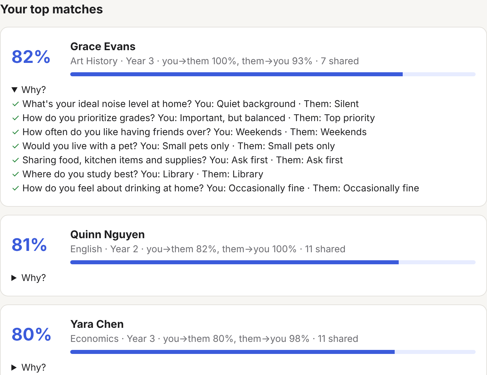

# CampusMatch

[](https://github.com/PeterFinkle/CollegeOkCupidProject/actions/workflows/ci.yml)

CampusMatch matches college students for compatibility. Students answer lifestyle questions, say
which answers they'd accept from someone else, and rate how much each question matters. The app
then does two things:

1. **Ranked recommendations.** It gives each student a ranked list of their best matches, with a
   per-question explanation of each score.
2. **Roommate pairing.** It splits a whole group into roommate pairs using **Irving's stable
   roommates algorithm**. The result is a pairing where no two students would both rather room
   with each other than with their assigned partners. When no such pairing exists, it falls back
   to a greedy pairing that is provably stable on the mutual match score.

It's a Python library, a REST API (FastAPI) that stores profiles in memory or in SQLite, a CLI,
and a small web UI with no dependencies. An optional NumPy path scores a whole population 30–40x
faster than the pure-Python scorer and gives the same numbers. It has 65 tests, including a
brute-force check of the pairing algorithm against every possible pairing on random inputs, and
a check that the NumPy path matches the scalar scorer on every pair.



## Quick start

```bash
pip install -e ".[dev]"
campusmatch serve            # web UI at http://127.0.0.1:8000, API docs at /docs
campusmatch serve --db campus.db   # same, but profiles persist in a SQLite file
campusmatch demo             # top matches for a few synthetic students
campusmatch pair --students 20
campusmatch bench --students 500
pytest -q
```

Or with Docker. The second form keeps profiles in a volume across container restarts:

```bash
docker build -t campusmatch .
docker run -p 8000:8000 campusmatch
docker run -p 8000:8000 -v campusmatch:/data campusmatch \
  campusmatch serve --host 0.0.0.0 --db /data/campus.db
```

`pip install -e ".[fast]"` adds only NumPy, for the vectorized scorer (the `dev` extra includes it).

On first start the store is seeded with 60 synthetic students. Seeding happens only when the store
is empty, so restarting on an existing database keeps everyone who signed up.

## How scoring works

For every question both students answered:

| Step | Formula |
|---|---|
| Importance weights | irrelevant 0, a little 1, somewhat 10, very 50, mandatory 250 |
| A's satisfaction with B | Σ A's weight where B's answer is acceptable to A ÷ Σ A's weight |
| Match | √(sat_A × sat_B) − 1/n_shared, floored at 0 |

Three reasons for this design:

- **Geometric mean.** It punishes one-sided matches. A 100% / 40% pair scores 63%, where an
  arithmetic mean would give 70%. Compatibility should require both people to be happy.
- **Geometric importance weights.** One "mandatory" question outweighs dozens of trivial ones, so
  it works almost like a dealbreaker. It still isn't a hard filter, which keeps everyone matchable.
- **Margin of error (−1/n).** It keeps two people who agree on a single question from showing up
  as a "100% match" ahead of people who agree on 11 out of 12.

## How roommate pairing works

Ranking matches for one person is easy. Splitting a whole dorm into pairs is the interesting
part. Each student ranks everyone else by how well the other student's answers satisfy *their
own* preferences. That ranking is **asymmetric**: Alex can rank Sam first while Sam ranks Alex
last.

- `stable_roommates()` implements Irving's two-phase algorithm (1985). Phase 1 is a round of
  proposals and rejections. Phase 2 finds and removes "rotations" until every preference list has
  one entry left. It either returns a stable pairing or proves that none exists.
- Unlike stable *marriage*, the roommates problem can have **no** stable solution. In this
  project's synthetic data, a stable pairing existed for 4 of 5 random groups of 20 students, 2 of
  5 groups of 100, and 0 of 5 groups of 400. When none exists,
  `pair_roommates()` falls back to `greedy_pairs()`, which pairs students by descending mutual
  score. The mutual score is symmetric, so this greedy pairing is stable with respect to it: no
  pair outside the result has a higher score than both of their assigned partners.
- An odd-sized group gets a sentinel "nobody" that everyone ranks last, so exactly one student is
  left unpaired.

### How it's verified

`tests/test_matching.py` enumerates every perfect matching for random inputs with n = 2, 4, 6
and 8 people (up to 105 matchings each, 510 random instances in total). It checks that whenever
Irving returns a pairing, that pairing is stable, and that whenever Irving returns `None`, no
stable pairing exists. It also covers the classic unsolvable 4-person instance and the textbook
6-person example.

## API

| Method | Path | Description |
|---|---|---|
| GET | `/questions` | Question bank |
| GET | `/importance-levels` | Importance names and weights |
| POST | `/profiles` | Create a profile with answers (validated; returns 422 with a reason) |
| GET | `/profiles?limit&offset` | Paginated list |
| GET | `/profiles/{id}` | One profile |
| GET | `/profiles/{id}/matches?k=10` | Top-k matches, both directions of satisfaction |
| GET | `/compare/{a}/{b}` | Score plus a per-question breakdown, disagreements first |
| POST | `/roommates` | Body: list of ids. Returns pairs, unpaired student, and method used |
| GET | `/health` | Liveness check |

Interactive docs are at `/docs` (OpenAPI).

## Storage

`storage.py` has two stores behind one small `ProfileStore` interface (`add`, `add_many`, `get`,
`all`, `len()`): the in-memory `Store` used by default and in tests, and `SQLiteStore`, which uses only
the standard library `sqlite3`.

- Two tables: `profiles`, and `answers` keyed by (profile, question). The set of acceptable
  options is stored as an integer bitmask, so "is B's answer acceptable to A?" is a single bit
  test, in SQL or in NumPy.
- FastAPI runs sync endpoints in a thread pool. The store shares one connection across threads
  (`check_same_thread=False`) and serializes access with a lock. It uses WAL journaling, so a
  commit is an append rather than a journal rewrite.
- Saving a profile is an upsert that replaces its answers in one transaction, which matches what
  the in-memory dict does.

## Performance

Measured with `campusmatch bench` on a 4-vCPU cloud VM (Xeon @ 2.1 GHz), Python 3.13, NumPy 2.5,
over three runs:

| Students | Pure Python (`top_matches` per student) | NumPy (`fast.py`) | Speedup |
|---:|---:|---:|---:|
| 500 | 1.0–1.2 s (≈230k pair scores/s) | 0.03 s (≈7.5M pair scores/s) | 30–36x |
| 2000 | 17.5–18.5 s (≈220k pair scores/s) | 0.46–0.52 s (≈8.5M pair scores/s) | 34–40x |

Both columns do the same work: score every ordered pair, then take each student's top 10.

- **Why the NumPy path is fast.** `fast.encode` packs the population into per-question arrays
  (choice, acceptable bitmask, importance weight, answered mask). Then each n×n quantity is one
  matrix product. Shared-question counts are `answered @ answered.T`. Possible weight is
  `weight @ answered.T`. Earned weight multiplies each student's weighted, unpacked bitmask by
  everyone's one-hot choices. The weights are small integers, so the float64 sums are exact and
  the matrix equals `scoring.score` bit for bit. The tests check this on every pair, including
  pairs with no shared questions and judges who marked everything irrelevant.
- **Where the time goes at 2000 students.** Encoding takes 0.01 s. The matrix products take
  0.12 s, which is about 32M pair scores/s. The rest is top-k selection: one stable sort per
  row, which keeps tie-breaking identical to `top_matches`. Memory is O(n²), a few 32 MB
  matrices at n = 2000.
- **Roommate pairing** still uses pure Python: 2.4 s for 500 students, 62 s for 2000. Building
  the preference lists is O(n² log n) score calls. Irving runs in O(n²) list operations in
  principle; this implementation uses `list.remove`, which adds a factor of n.

What I'd change next at scale: build the preference lists for pairing from the NumPy matrices,
cache the score matrix and invalidate it one row and column per profile on update, and narrow
candidates first (same school year, housing area) before scoring.

## Project layout

```
src/campusmatch/
  models.py     Question, Answer, Profile, Importance
  scoring.py    satisfaction, match score, explanation
  matching.py   top-k, Irving's algorithm, greedy fallback, stability check
  fast.py       optional NumPy path: n×n match matrix, top-k from a matrix row
  data.py       question bank + seeded synthetic population (persona-based)
  storage.py    ProfileStore interface, thread-safe in-memory and SQLite stores
  api.py        FastAPI app over any ProfileStore
  cli.py        demo / pair / bench / serve [--db]
  static/       single-page UI (vanilla JS, light + dark mode)
tests/          scoring, matching (incl. brute-force), NumPy vs scalar, storage, API
```

## Next steps

- Postgres instead of SQLite once the API runs on more than one machine (a third
  `ProfileStore`).
- Authentication, so each student can only edit their own profile.
- Learn importance weights from which matches students actually message or accept.
- Group housing (suites of 3–4), which is NP-hard in general and would need a heuristic or an ILP.

---

This repo also has a job-search kit in [`docs/career/`](docs/career/): resume bullets,
interview prep, and an application tracker.
